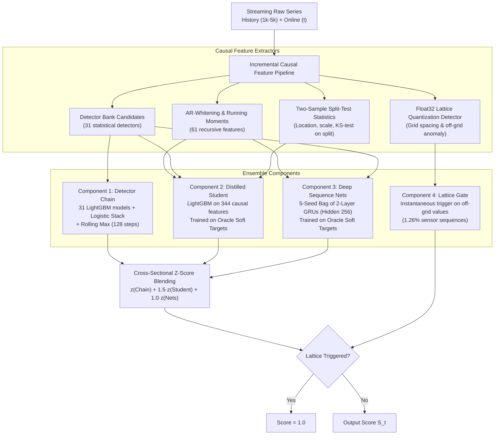

# ADIA Lab Structural Break Challenge: Real-Time Edition

[](https://hub.crunchdao.com/competitions/structural-break-real-time)
[-brightgreen.svg)]()
[]()
[]()

Our end-to-end research notebook, experimentation log, and production pipeline for the **[ADIA Lab Structural Break Challenge: Real-Time Edition](https://hub.crunchdao.com/competitions/structural-break-real-time)** hosted on CrunchDAO (May to October 2026).

We finished the public competition with **TS-AUC 0.6367 (Top ~15%)**, culminating in a late-submission float32 lattice gate (Submission 43) that delivers an additional **+0.0086 simulated TS-AUC (+0.0268 on local test)**.

This repository serves as a complete **open lab notebook holding 177 numbered experiments**, each containing full reproducible code and a dedicated `readme.txt` documenting the hypothesis, implementation, empirical metrics, and post-mortem analysis (including dozens of negative results and leak traps).

---

## Table of Contents
- [The Challenge & Problem Formulation](#the-challenge--problem-formulation)
- [System Architecture](#system-architecture)
- [Leaderboard Progression](#leaderboard-progression)
- [The Final Ensemble](#the-final-ensemble)
- [Key Breakthroughs: What Really Worked](#key-breakthroughs-what-really-worked)
- [The Graveyard: Negative Results & What Failed](#the-graveyard-negative-results--what-failed)
- [Validation Protocol & Traps Caught](#validation-protocol--traps-caught)
- [Repository Map & Landmark Experiments](#repository-map--landmark-experiments)
- [Reproduction & Quickstart Guide](#reproduction--quickstart-guide)
- [Human-AI Collaborative Research](#human-ai-collaborative-research)

---

## The Challenge & Problem Formulation

In quantitative finance, macroeconomics, and sensor telemetry, detecting regime shifts as quickly as possible without generating false alarms is a foundational problem.

```
Time ---------------------------------------------------------------------------------------->
[======== 1,000 - 5,000 History Points ========] [============= 10 - 1,000 Online Points =============]
                (No break, stationary)          t=1      t=2    ...   t=tau (Break!)   ...   t=T
                                                 |        |             |                     |
                                                s_1      s_2           s_tau                 s_T
                                                (Strictly causal score: P(break <= t) in [0, 1])
```

1. **Input Structure**:
   - **History Segment**: 1,000 to 5,000 observations of steady-state behavior with guaranteed absence of breaks.
   - **Online Segment**: 10 to 1,000 observations arriving strictly **one point at a time**.
2. **Causal Constraint**:
   - At every time step $t$, your model must output a confidence score $S_t \in [0, 1]$ indicating whether a structural break has **already occurred** ($\tau \le t$).
   - Future data ($t+1, \dots, T$) is completely inaccessible. Exactly 50% of the sequences contain a structural break; the other 50% never break.
   - Breaks can manifest as shifts in mean, variance, autoregressive dynamics, distribution shape, or dependency structure.
3. **Evaluation Metric: Time-Step AUC (TS-AUC)**:
   - At each individual online step $t$, an ROC AUC is computed across all time series still active at step $t$.
   - The overall score is the weighted average across all time steps:
     $$\text{TS-AUC} = \frac{\sum_{t} w_t \cdot \text{AUC}_t}{\sum_{t} w_t}, \quad \text{where } w_t = N_{\text{pos}}(t) \cdot N_{\text{neg}}(t)$$
   - **Crucial Metric Insight**: Only the cross-sectional **ranking within each time step** matters. Calibration or monotonic drift across time steps $t$ has zero penalty; correctly ordering active series at each moment is everything.

---

## System Architecture

The final deployment blends three diverse modeling paradigms plus a high-precision numerical quantization gate, executing causally with constant-memory incremental state updates:



---

## Leaderboard Progression

| Milestone | Public TS-AUC | Key Structural Change | Experiments |
|---|:---:|---|---|
| **Sub 28/29** | 0.6243 | Tree "Chain": 31-detector bank $\to$ logistic stacker $\to$ 128-step rolling max | Models 1–29 |
| **Sub 30** | 0.6296 | **Oracle Knowledge Distillation**: Student trained on non-causal teacher soft targets | Models 109–111 |
| **Sub 31** | 0.6309 | **Neural Sequence Diversity**: Added GRU student on AR-whitening & detector features | Models 112–124 |
| **Sub 33** | 0.6331 | **Split-Test Hypothesis Features** + start-shifted **Re-cut Series** augmentation | Models 144–147 |
| **Sub 40** | 0.6340 | Student retrained on all 10,000 labelled sequences (development + sealed holdout) | Models 154 |
| **Sub 41** | 0.6363 | Scaled GRU capacity (hidden dimension 256, 2 layers) with oracle soft targets | Models 169–170 |
| **Sub 42** *(Final)* | **0.6367** | Full-data retrained GRU ensemble (Top ~15% on public cloud leaderboard) | Models 170–176 |
| **Sub 43** *(Late)* | **~0.645** *(est)* | **Float32 Lattice Gate**: Exploiting quantization grids in physical sensor series (+0.0268 local) | Model 177 |

*Note: In the competition, top 10 prize threshold was ~0.652, and 1st place was 0.663.*

---

## The Final Ensemble

The complete submission pipeline combines four components evaluated step-by-step:

$$\text{Final Score}_t = z(\text{Chain}_t) + 1.5 \cdot z(\text{Student}_t) + 1.0 \cdot z(\text{Nets}_t) \quad [\text{Overridden if Lattice Gate fires}]$$

### 1. The Detector Chain (LightGBM Stack)
- **Features**: 31 diverse change-point detectors (CUSUM, Shiryaev-Roberts, GLR, recursive variance ratios, running quantiles).
- **Architecture**: Individual LightGBM classifiers for each detector $\to$ 34-column logistic regression stacker $\to$ 128-step rolling maximum.
- **Role**: Provides robust conservative baseline predictions for large, abrupt step changes.

### 2. The Distilled Student (LightGBM on Soft Targets)
- **Features**: 317 causal running features + 27 two-sample split-test statistics.
- **Training Strategy**: Trained on **soft targets** ($0.5 \cdot y + 0.5 \cdot P_{\text{oracle}}$) generated by an offline non-causal Oracle Teacher that had full access to the entire sequence and known break location.
- **Data Augmentation**: 40% sample weight assigned to synthetic series generated via real-tail splicing and three pools of start-shifted re-cut series.
- **Role**: The single strongest individual predictor in the ensemble.

### 3. The Deep Sequence Nets (5-GRU Ensemble)
- **Architecture**: 5 randomly seeded 2-layer GRUs with 256 hidden units.
- **Inputs**: 102 incremental channels (61 recursive AR-whitened features + 40 raw detector outputs + $\log(1+t)$ elapsed time index).
- **Training**: Sequence-level binary cross-entropy on oracle soft targets with cosine annealing and gradient clipping.
- **Role**: Highly orthogonal representation compared to decision trees; adds +0.003 to +0.005 when blended despite lower standalone score (~0.620).

### 4. The Float32 Lattice Gate (Precision Fingerprinting)
- **Mechanism**: Detects underlying uniform quantization grids ($V \in \{k \cdot \Delta + \phi\}$) characteristic of physical sensor ADCs stored in float32.
- **Behavior**: On confirmed lattice series (1.26% of all sequences), tracks off-grid floating-point values created by synthetic break splicing. Fires instantaneously when off-grid anomalies appear (mean detection delay of 0.12 steps with 0.0% false alarm rate on negative controls).
- **Impact**: +0.0268 TS-AUC on local 100-series test set; simulated +0.0086 gain across the full 10,000 dataset.

---

## Key Breakthroughs: What Really Worked

Across 177 numbered experiments, six specific algorithmic breakthroughs yielded virtually all competitive gains:

### 1. Oracle Knowledge Distillation (Models 109–111, 157)
- **Problem**: In online break detection, early online steps have high posterior uncertainty. Hard binary labels ($y \in \{0, 1\}$) brutally penalize probabilistic caution, driving trees to over-sharpen.
- **Solution**: We trained an offline *Oracle Teacher* with bidirectional access to the complete online future and ground-truth $\tau$. The causal *Student* was trained on blended soft targets:
  $$y_{\text{distill}} = 0.5 \cdot y_{\text{true}} + 0.5 \cdot P_{\text{oracle}}(\text{break} \le t \mid X_{1:T})$$
- **Impact**: **+0.0070 TS-AUC** raw improvement on the causal student, breaking a month-long performance plateau.

### 2. Spliced Series from Real Tails (Model 18 onward)
- **Problem**: Parametric simulation (adding Gaussian/Student-t steps) failed to generalize to real dataset dynamics.
- **Solution**: We spliced the un-broken history of Series $A$ with the genuine post-break tail of Series $B$.
- **Takeaway**: Synthetic breaks only improve generalization if the post-break noise structure, autocorrelation, and heteroskedasticity come from real data.

### 3. Causal Split-Test Hypothesis Features (Model 144)
- **Methodology**: At each step $t$, compute the single most likely split point $\hat{\tau} \in [1, t]$ via cumulative sum deviations on AR-whitened residuals.
- **Features**: Compute two-sample tests comparing $[\text{History} \cup 1:\hat{\tau}]$ against $[\hat{\tau}+1:t]$:
  - Location shift: Welch's $t$-statistic & Mann-Whitney $U$
  - Scale shift: Brown-Forsythe & Levene variance ratio
  - Distributional shift: Two-sample Kolmogorov-Smirnov test statistic
- **Impact**: **+0.0037 TS-AUC** across all 5 cross-validation folds.

### 4. Start-Shifted "Re-cut" Augmentation (Models 147, 163)
- **Methodology**: Rather than altering the data values, move the history boundary: transfer the first $s$ online points into the history segment.
- **Effect**: The exact same physical break now occurs at step $t - s$ rather than $t$. This forces models to decouple time index $t$ from break probability. Three pooled re-cut sets gave the largest student gain after distillation.

### 5. Full-Data Retraining (Models 154, 170)
- Once feature selection, regularization, and blending ratios were locked and verified against our sealed holdout, retraining both the student LightGBM and the GRU nets across all 10,000 labelled series yielded **+0.0069 raw TS-AUC** on neural nets and **+0.0027** on the overall blend.

### 6. Ensemble Orthogonality (Models 124, 169)
- GBDT models partition feature space with axis-aligned splits; GRUs track smooth hidden state trajectories over recursive autoregressive filters. Despite lower individual TS-AUC (~0.620 vs 0.634), the GRU ensemble contributed **+0.0027 net TS-AUC** when blended with the trees.

---

## The Graveyard: Negative Results & What Failed

Rigorous research means systematically eliminating plausible hypotheses that fail under controlled evaluation:

```
                                  HYPOTHESES TESTED
                                          |
                +-------------------------+-------------------------+
                |                                                   |
         PROVEN LEVERS                                        THE GRAVEYARD
  * Oracle Soft-Target Distillation                  * Parametric Noise Injection (M134-135)
  * Real-Tail Spliced Sequences                      * Fourier & Moment Feature Explosion (M114, 133)
  * Causal Two-Sample Split Tests                    * 4th Linear/Tree Blenders (Ridge/ET) (M175)
  * Start-Shifted Re-cut Augmentation                * Temporal TCNs with GroupNorm Leak (M143)
  * Neural Recurrent Diversity (GRUs)                * Time-Varying Dynamic Blending (M14, 142)
  * Float32 Quantization Grid Analysis               * High-Capacity Sequence Nets (M169, 172)
```

1. **Parametric & Bootstrap Data Synthesis (Models 134–135)**:
   - Injecting synthetic Gaussian, Student-$t$, or autoregressive steps degraded cross-validation. Only real donor tails preserved true tail risk.
2. **Feature Dimensionality Explosion (Models 114, 133, 149)**:
   - Expanding to 500+ features using moment banks and Fourier spectra caused tree overfitting.
   - Integrating break evidence over all possible break positions produced the single strongest standalone feature ever measured (0.588 TS-AUC) yet added **0.0000** to the existing ensemble.
3. **Derived Sequences for Neural Nets (Models 172–173)**:
   - Training GRUs on re-cut, spliced, or mirrored sequences failed to improve test scores. Neural models suffered from subtle distributional shift in synthetic concatenations.
4. **Fourth Blend Components (Model 175)**:
   - Adding Ridge Regression or ExtraTrees models trained on identical feature sets yielded $+0.00007$ to the blend (negligible).
5. **Time-Varying Blend Weights & Post-Processing (Models 14, 142)**:
   - Decaying or shifting blend weights as a function of online step $t$ produced dev gains that completely evaporated on the sealed holdout.

---

## Validation Protocol & Traps Caught

### 1. Dual-Tier Validation Split
- **Development Set (8,333 series)**: Grouped into 5 series-level folds for iterative feature selection and hyperparameter exploration.
- **Sealed Outer Holdout (1,667 series)**: Completely isolated and untouched during modeling. Evaluated only as a final gating check before submitting to the cloud platform.
- **Why It Mattered**: After 100+ iterations, the development CV became optimistic by ~0.006. The sealed holdout tracked the true cloud leaderboard to within **0.0014**.

### 2. The 2-Sigma Decision Rule
- A model or modification was only accepted into the pipeline if:
  1. The mean gain exceeded **2 standard errors** ($\Delta > 2 \times \text{SE}$).
  2. The candidate beat the baseline on **at least 4 out of 5 folds**.
- *Example*: Submission 34 showed a $+0.0013$ gain on development CV (5/5 folds) but lost $-0.0009$ on the sealed holdout. The decision rule correctly rejected it.

### 3. Critical Leak Traps Caught & Neutralized
- **The GroupNorm Leak (Model 143)**: A Temporal Convolutional Network (TCN) showed spectacular performance. Investigation revealed `GroupNorm` normalized across the time axis, inadvertently propagating future step information backward. Fixed by switching to strictly causal running layer normalizations.
- **The Spliced Donor Leak (Model 172)**: Spliced training sequences indexed by generation plan ID accidentally allowed donor tails from held-out validation folds into training sets. A single-fold spike of $+0.017$ immediately flagged the bug. Resolved via `split_splices.py` to enforce strict series-level donor isolation.
- **Neural Seed Noise (Model 176)**: Two GRUs trained on *identical data* with different random initializations showed up to **0.0064 TS-AUC variation on a single fold**. All subsequent neural ablations required paired-seed replication.

---

## Repository Map & Landmark Experiments

```
.
├── .github/
│   └── README.md                      # Public project overview & complete documentation
├── AGENTS.md                          # Standing operating instructions for coding agents
├── Data/                              # Competition data (external, not tracked in git)
├── Model/                             # 177 numbered research experiments (model1 ... model177)
│   ├── model1/                        # Initial baseline & detector framework
│   ├── model10/                       # Pairwise stacking & causal feature selection
│   ├── model109/                      # First oracle knowledge distillation breakthrough
│   ├── model111/                      # Production student-teacher pipeline
│   ├── model112/                      # Incremental deployment engine (Submission 31)
│   ├── model124/                      # First neural sequence student (GRU)
│   ├── model144/                      # Two-sample split-test hypothesis features
│   ├── model147/                      # Start-shifted re-cut series generation (Submission 33)
│   ├── model154/                      # Full-data student retraining (Submission 40)
│   ├── model169/                      # High-capacity GRUs & vast.ai cloud training
│   ├── model170/                      # All-series neural training (Submission 41/42)
│   ├── model176/                      # Neural seed noise audit & 2025 external data evaluation
│   ├── model177/                      # Float32 lattice quantization gate (Submission 43)
│   ├── PIPELINE_SUBMISSION42.txt      # Complete production specification for Submission 42
│   └── FINAL_EVALUATION_RULES.txt     # Submission selection protocol
└── Other/                             # Tooling, environment, tests, and utility scripts
    ├── requirements.txt               # Locked Python dependencies
    ├── gitignore.txt                  # Allow-list exclusion specification
    ├── backup_github.ps1              # Automated git backup pipeline
    └── restructure_layout.ps1         # Symlink environment reconstructor
```

### Essential Reading List:
- [`Model/PIPELINE_SUBMISSION42.txt`](../Model/PIPELINE_SUBMISSION42.txt): Full end-to-end specification of the public 0.6367 model.
- [`Model/model177/readme.txt`](../Model/model177/readme.txt): Complete mathematical derivation and validation of the float32 lattice gate.
- [`Model/model109/readme.txt`](../Model/model109/readme.txt): Empirical logs proving the oracle distillation concept.
- [`Model/model144/readme.txt`](../Model/model144/readme.txt): Mathematical formulations of the two-sample split-test features.

---

## Reproduction & Quickstart Guide

### Prerequisites
- Python 3.10+ (tested on Python 3.12 64-bit on Windows and Linux).
- Optional: CUDA-capable GPU (RTX 3090 / A100) for training the 5-GRU neural ensemble.

### 1. Environment Setup
```bash
# Clone the repository
git clone git@github.com:yodharin-monplub/adialab-realtime.git
cd adialab-realtime

# Create virtual environment
python -m venv Other/.venv

# Activate virtual environment
# Windows:
.\Other\.venv\Scripts\Activate.ps1
# Linux/macOS:
source Other/.venv/bin/activate

# Install dependencies
pip install -r Other/requirements.txt
```

### 2. Path Symlinks Setup
The codebase uses standardized directory links (`models/`, `train/`, `submissions/`) matching the cloud platform:
- **Windows (PowerShell as Admin or Developer Mode enabled)**:
  ```powershell
  powershell -File Other/restructure_layout.ps1 -LinksOnly
  ```
- **Linux / macOS**:
  ```bash
  ln -s Model models
  ln -s "Data/ADIA Lab Structural Break Challenge Real-Time Edition" train
  ln -s Other/.venv .venv
  mkdir -p submissions
  ```

### 3. Data Download
1. Download the competition dataset from [CrunchDAO Hub](https://hub.crunchdao.com/competitions/structural-break-real-time).
2. Place files into:
   ```
   Data/ADIA Lab Structural Break Challenge Real-Time Edition/
       ├── X_train.parquet
       ├── y_train.parquet
       ├── X_test.parquet
       └── (optional reduced test sets)
   ```

### 4. Running Validation & Inference
To validate the final Submission 42 / 43 pipeline locally on the 100-series test sample:
```bash
# Run local end-to-end validation
python Model/model177/validate177.py 100
```
To reproduce training of individual components, follow the explicit commands recorded in each model's `readme.txt` (e.g. `python Model/model154/run_all.py AP1`).

---

## Human-AI Collaborative Research

This project was built through a tight human-AI research loop:
- **Human Principal Investigator**: Problem formulation, strategic roadmap, architectural hypotheses (distillation concepts, split-testing, re-cut series, lattice gate discovery), validation guardrails, and submission decisions.
- **Autonomous Coding Agents (Claude Code / Antigravity)**: End-to-end script generation, feature engineering, fast-turnaround experimentation across 177 models, automated metric logging, bug hunting, and code audits.

---

## License & Citation

The source code and documentation in this repository are provided under the MIT License for academic and quantitative research purposes.

If you find our methodology, distillation framework, or split-test features useful in your research or change-point detection applications, please cite:

```bibtex
@misc{adialab_realtime_structural_break_2026,
  author = {Yodharin Monplub and contributors},
  title = {Real-Time Structural Break Detection via Oracle Knowledge Distillation, Causal Hypothesis Testing, and Neural Ensembles},
  year = {2026},
  publisher = {GitHub},
  howpublished = {\url{https://github.com/yodharin-monplub/adialab-realtime}}
}
```
